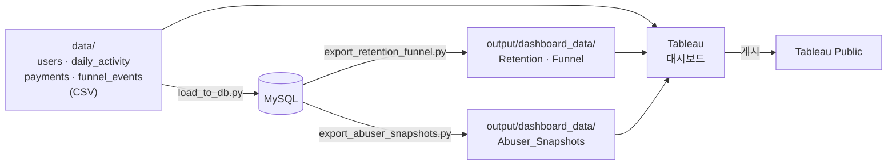

## Tableau 대시보드: Astrasia Online MMORPG KPI 대시보드

가상의 MMORPG **Astrasia Online**의 데이터로, 매일 아침 업데이트된 KPI와 어뷰징 의심 유저를 한 화면에서 확인하기 위해 만든 대시보드입니다.


🔗 **[Tableau Public에서 보기](https://public.tableau.com/app/profile/daun.kim2884/viz/261117_astrasia/Overview)**

> 모든 데이터는 직접 설계해 생성한 **합성 데이터**입니다. 실제 게임이나 실제 유저의 데이터가 아닙니다.

---

### 누구를 위한 대시보드인가

게임 운영 담당자가 **매일 아침 또는 실시간으로** KPI와 이상 유저를 확인하는 용도입니다.
모든 페이지에서 **국가, 플랫폼, 현재 레벨, 조회 기간**으로 걸러 볼 수 있습니다.

---

### 페이지 구성

#### 1. 요약

- **주요 KPI**: 운영에서 가장 중요한 것은 유저 수, 유입 수, 결제라고 판단해 **DAU, 신규 유저, 결제 유저, 결제 전환율, 매출, ARPPU** 6개를 KPI로 정했습니다.
- 가상 데이터를 설계할 때 프로모션을 넣었습니다. 프로모션마다 유저가 얼마나 관심을 보였는지(DAU), 신규 유저가 들어왔는지(신규 유저), 가장 중요한 결제로 이어졌는지(결제 유저, 매출, ARPPU)를 한눈에 볼 수 있게 했습니다.
- **국가별 보기**: Astrasia는 여러 국가에서 운영됩니다. 보기 방식을 `국가별`로 바꾸면 국가별 추이와 비교 막대를 볼 수 있습니다. 국가 맞춤형 프로모션을 설계하거나 어느 국가에 운영을 집중할지 판단하는 데 쓸 수 있습니다.

#### 2. 유저 상세

- **과금 등급**: 온라인 MMORPG에서 과금은 핵심 요소입니다. 유저를 5개 과금 등급으로 나누어, 등급별 활성 유저 추이와 활성 유저·매출 구성을 보여 줍니다. 이후 과금 상품을 설계할 때 활용할 수 있습니다.

  | 등급 | 최근 90일 결제액 (KRW) |
  |---|---|
  | Free | 0 (결제 없음) |
  | Minnow | 1 ~ 15,999 |
  | Dolphin | 16,000 ~ 219,999 |
  | Whale | 220,000 ~ 406,999 |
  | Super Whale | 407,000 이상 |

  <!-- TODO: 과금 등급을 5단계로 나눈 이유와 경계값의 근거 추가 -->

- **어뷰저 판정**: 어뷰저는 인게임 인플레이션과 일반 유저의 불만으로 이어집니다. 이를 모니터링할 수 있도록 유저를 `정상`, `의심`, `고위험 의심`으로 분류했습니다.
- **어뷰징 신호별 유저 수**: 신호(장시간 플레이, 빠른 골드 획득, 빠른 아이템 획득, 규칙적 획득 패턴, 빠른 성장)별로 유저 수를 보여 줍니다. 어떤 유형을 우선적으로 막고 주요하게 모니터링해야 할지 판단할 수 있습니다.

#### 3. 신규 유저 상세

- **리텐션 추이 / 가입 주차별 리텐션**: 가입 후 D1, D3, D7, D14 리텐션을 봅니다. 특정 프로모션이나 경쟁 심화 같은 외부 요인이 유저 잔존에 준 영향을 파악할 수 있습니다.
- **성장 퍼널**: 가입 → 튜토리얼 완료 → 레벨 10 도달 → 첫 던전 클리어 → 레벨 30 도달 단계별 유저 수와 전환율을 봅니다. 병목이 생기는 단계를 찾아, 유저가 특히 어려움을 겪는 구간이나 특정 지점의 버그 가능성을 확인할 수 있습니다.

#### 4. 골드·아이템

- **유저당 골드·아이템 획득량**: 인게임 재화와 아이템 획득량이 일정하게 유지되는지 모니터링합니다.
- 평균과 중앙값을 함께 보여 줍니다. 두 값의 차이가 커지면 어뷰징 유저가 있거나, 유저마다 비슷해야 할 획득 확률에 차이가 생겼을 수 있다는 신호로 볼 수 있습니다.

---

### 지표 정의와 기준

| 항목 | 기준 |
|---|---|
| KPI 카드 | 조회 기간 **마지막 날 하루**의 값. 등락률은 그 직전일 대비 |
| 과금 등급 | 조회 기간 마지막 날 기준 **최근 90일** 결제액 |
| 어뷰저 판정 | 조회 기간 마지막 날 기준 **최근 30일** 활동, **접속일 7일 이상**인 유저 대상 |
| 과금 등급·어뷰저 대상 | 조회 기간에 접속한 유저 |
| 리텐션 (D1~D14) | 가입 후 정확히 N일째 되는 날 접속한 비율. 아직 N일이 지나지 않은 가입자는 계산에서 제외 |
| 성장 퍼널 | 조회 기간에 가입한 유저가 데이터 마지막 날까지 도달한 단계 |

**KPI 카드를 마지막 날 하루 기준으로 한 이유**
매일 확인하는 대시보드로 설계했기 때문입니다. 조회 기간의 가장 최근 날짜 값과 직전일 대비 등락률을 보여 줍니다.

**과금 등급을 최근 90일로 한 이유**
30일 창은 **결제 주기가 긴 고과금 유저를 놓칩니다.** 같은 등급 기준을 최근 30일 결제액에 적용해 보면 다음과 같습니다.

- 90일 동안 결제한 유저 1,525명 중 **50.5%가 Free로** 분류됩니다.
- **Super Whale 16명이 한 명도 남지 않습니다**(Dolphin 11명, Whale 5명으로 하락). Whale도 144명 중 12명만 유지됩니다.
- 다시 결제한 유저의 결제 간격은 중앙값 13일이지만, 상위 10%는 40일 이상이고 간격의 18%가 30일을 넘습니다.

그래서 재결제 간격을 충분히 덮고 시즌 프로모션 주기도 포함하는 90일(한 분기)을 기준으로 정했습니다.

**어뷰저 판정을 최근 30일, 접속 7일 이상으로 한 이유**
- 어뷰저는 빠르게 확인해야 합니다. 어뷰저 탐지와 제재는 꾸준히 이루어지므로, 기간을 길게 잡으면 이미 제재된 계정까지 섞여 현재 상황을 흐리게 만든다고 판단했습니다.
- 어뷰징은 한 번으로 끝나기보다 꾸준히 반복될 가능성이 높아, 30일이면 충분히 드러난다고 보았습니다.
- 장시간 플레이나 규칙적 획득 패턴은 플레이 일수가 충분히 쌓여야 보입니다. 그래서 최소 일주일(7일) 이상 접속한 유저만 판정 대상으로 삼았습니다.

---

### 설계 결정

- **판정 시점은 조회 기간 마지막 날**: 과거 날짜를 조회 기간으로 고르면, 과금 등급과 어뷰저 판정도 **그 시점 기준**으로 보이게 했습니다. 지금 기준의 판정을 과거 화면에 덮어씌우지 않기 위해서입니다.
- **어뷰저 판정을 날짜별 스냅샷으로 저장**: 어뷰저 수와 각 유저가 보인 신호는 기간에 따라 달라져야 합니다. 그래서 하나의 고정 목록이 아니라, 날짜마다 그날 기준으로 판정한 결과를 미리 계산해 두고(`Abuser_Snapshots`), 대시보드는 조회 기간 마지막 날의 스냅샷을 읽습니다.
- **1600×900 고정 크기**: 한 페이지의 내용이 한 화면에 모두 들어와 한눈에 파악하기 쉽도록 고정했습니다.

---

### 데이터 흐름



- 기본 지표(유저, 접속, 결제)는 `data/`의 CSV를 Tableau에 바로 연결해 계산합니다.
- 리텐션·퍼널 테이블과 어뷰저 스냅샷은 SQL로 계산이 필요해, MySQL에서 파이썬 스크립트로 만들어 `output/dashboard_data/`에 저장합니다.

```
output/
├── abuser_list/      # 일일 어뷰저 리스트
├── dashboard_data/   # 대시보드 전용 데이터 (리텐션, 퍼널, 어뷰저 스냅샷)
└── reports/          # 일일 엑셀 리포트
```

---

### 한계와 해석 시 유의점

- **현재 레벨 슬라이더의 범위는 고정값입니다.** 최고 레벨이 60보다 높아지면 필터 범위를 다시 지정해야 합니다.
- **최근 가입자의 퍼널 해석에 주의가 필요합니다.** 조회 기간 마지막 날이 최근일수록, 최근 가입한 유저는 가입부터 레벨 30 도달까지의 시간이 충분하지 않아 뒤쪽 단계에 아직 도달하지 못했을 수 있습니다.
